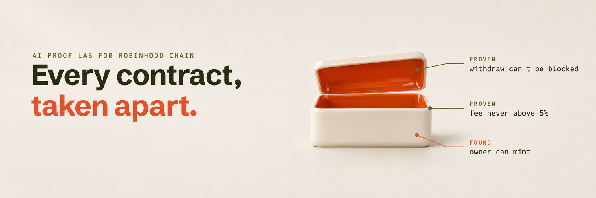

# Kea



[](https://github.com/keaproofs/kea/actions/workflows/ci.yml)
[](https://github.com/keaproofs/kea/actions/workflows/codeql.yml)
[](https://scorecard.dev/viewer/?uri=github.com/keaproofs/kea)

Kea answers plain-word questions about contracts deployed on Robinhood Chain with evidence you can re-run.

- **Proven:** what a contract cannot do, proven for every caller and input the check covers.
- **Found:** what its own admin can do, replayed on a copy of the live chain, with who holds the power.
- **Unclear:** everything Kea could not decide, with the reason.

Kea does not give opinions. Every verdict comes from a test file anyone can download and run.

## A real report

VaultV2 (`0x75999324313103e54540dc040050fc823e0ef4ef`), from Kea's model evaluation on 25 Nov 2026:

```
$ kea score <batch> --claims
       VaultV2                        drafts 2 built Y prove   77s proven 5 findings 2 dropped 0 unreplayed 0 weak 0 unknown 0 $0.43
      finding            V1_freeze        The owner can freeze all withdrawals by installing a gate  [scope: redeem]
      proven             T2_seize         Nobody without approval can take a holder's vault shares  [scope: transferFrom]
      proven             O1_setOwner      Only the owner can change the owner  [scope: setOwner]
      proven             T4_fee           The performance fee can never exceed 50%  [scope: setPerformanceFee]
      proven             T4_mgmt          The management fee can never exceed 5% per year  [scope: setManagementFee]
      proven             T4_penalty       The forced-exit penalty can never exceed 2%  [scope: setForceDeallocatePenalty]
      finding            O1_setCurator    The owner can replace the curator at any time  [scope: setCurator]
```

Five protections proven and two of the owner's powers replayed, for $0.43 of model use.

## Re-run any proof yourself

Every published report links the test file that decided it. In a Foundry project that holds the contract's verified
source:

```
curl -o test/Proof.t.sol https://keaproofs.io/v1/contracts/<address>/test
halmos --contract ProofTest --function check_
RH_RPC=<robinhood chain rpc> forge test --match-test test_replay
```

You can also let Kea rebuild the project from the explorer and prove the same file:

```
kea prove <address> --claims result.json --test Proof.t.sol
```

## How a contract is taken apart

1. **Fetch.** Kea reads the verified source from Sourcify, then from Blockscout. It follows EIP-1967 proxies to the
   code that runs.
2. **Draft.** A model (Claude, through the Anthropic API) writes plain-word claims from a fixed catalog, then a
   Foundry test whose `check_` functions decide them.
3. **Refuse.** A draft is refused before it runs if it reaches for files, FFI or the environment, or forks anything
   but the chain. Tools run with an empty environment, so a test cannot read Kea's own keys.
4. **Prove.** halmos runs every check symbolically.
5. **Replay.** Counterexamples are replayed on a fork of the live chain, and the replay records who holds the power:
   a person's account, a Safe and its threshold, another contract, or nobody.
6. **Review.** A second reading compares each proven claim's words with its checks. A claim whose words say more
   than its checks prove loses its proof. The review fails closed: a claim it cannot clear is not proven.
7. **Redraft.** Compiler errors, prover output and review notes go back into the next draft, up to four drafts.
   Kea keeps the best attempt.

## Rules Kea holds itself to

- A counterexample that does not replay is never shown as a finding.
- A replay that writes storage no real account could write is thrown out.
- A protection that breaks may be a hole anyone can use. It goes privately to the deployer first and stays out of
  every public view until then (see [SECURITY.md](SECURITY.md)).
- Identical code is proved once and reused. When a proxy is pointed at new code, its report is marked stale and
  re-checked.

## Repository

| Path | What it is |
| --- | --- |
| `crates/kea-core` | Claims, verdicts and scoring |
| `crates/kea-chain` | Robinhood Chain RPC client |
| `crates/kea-sources` | Verified-source fetching and Foundry project setup |
| `crates/kea-prover` | Running forge and halmos under limits |
| `crates/kea-claims` | Drafting and reviewing with the Anthropic API |
| `crates/kea-engine` | The draft, prove and review loop |
| `crates/kea-cli` | The `kea` command |
| `crates/kea-api` | The HTTP API, its worker and the change watcher |
| `site/` | The website (React, Vite, TypeScript) |
| `contracts/` | The bounty pool, fee splitter and burner, with Kea's own proofs of them and the deploy script |
| `ops/keeper/` | The keeper that sweeps, splits and burns the fees every hour |
| `docs/` | The [API](docs/api.md) and the [contracts](docs/contracts.md): roles, money path and what is proven |

## Build

You need:
- Rust 1.90 or newer;
- Foundry and halmos;
- GNU time;
- the test libraries in `/opt/lib`: `forge-std` and `halmos-cheatcodes`.

Contracts built with solc older than 0.8.13 also need the legacy set in `/opt/lib/legacy`: forge-std 1.9.7 plus the
cheatcodes with their pragma lowered.

```
cargo build --release
export ANTHROPIC_API_KEY=...            # drafting and review
./target/release/kea ask <address>      # take a contract apart
./target/release/kea-api serve          # the API; see crates/kea-api/src/config.rs for settings
```

Site: `cd site && npm ci && npm run dev`.

Contracts: `cd contracts && forge test && halmos --function check_`. The whole fee path runs against the launchpad's
real contracts on a fork of the live chain with `RH_RPC=<robinhood chain rpc> forge test --match-contract ForkTest`.

## Break it, get paid

The bounty pool pays people who break a claim Kea published as proven. It has no pause and no upgrade:
- A bounty is proposed by the judge, in public, with its evidence.
- Anyone can pay a bounty out after two days.
- A claim is paid once.
- One bounty takes at most a quarter of the unpromised pool.
- The pool can close, so a project that ends does not strand it. The judge announces the close, and it takes effect
  30 days later. Until then bounties work as before, and every bounty proposed by then is still paid. After that,
  anyone can send the ETH no bounty is owed to the team address fixed at deploy.

20% of the token's creator fee funds the pool, through a splitter that nobody can change after deploy.
- The launchpad holds creator fees until their recipient collects them, and the splitter is that recipient.
- Anyone can have it collect: `sweepCurve` before graduation, `sweepPool` after it, then `release`.
- `release` sends 20% to the pool, 30% to the burner and the rest to the team.

## Every fee burns $KEA

The burner turns its share of the fees into $KEA and burns it. Before graduation it buys on the bonding curve, and
after graduation in the token's own Uniswap v4 pool.
- Its ETH can go nowhere else. Everything it buys is burned in the same call.
- The keeper burns on a schedule and sets the fewest tokens it accepts, so a burn can't be wrapped in trades that move
  the price first.
- If the keeper is silent for a week, anyone can burn, at most 0.1 ETH at a time, so the ETH never waits on one machine.
- The fork tests run the whole path against the live chain. With a 2% creator tax, a buy on the curve earns the
  splitter 2.7% of what was paid. The burn share is bought and burned on the curve, and also in a graduated launch's
  live pool.
- Kea's own proofs hold for any caller, any function and any arguments:
  - nobody but the keeper can make the burner spend within the week;
  - one burn by anyone else spends at most 0.1 ETH;
  - every token bought is burned;
  - the live pool can never be swapped;
  - a release pays exactly 20/30/50 and keeps nothing;
  - the splitter's ETH reaches only the pool, the burner and the team.

The addresses are published here once the contracts are deployed.

## Checks

Every push runs all of these, and each one runs locally too.

| Check | What it holds | Run it |
|---|---|---|
| Rust | formatted; clippy's pedantic set with no warnings; every test; a scored batch byte for byte | `cargo fmt --all --check`, `cargo clippy --all-targets --release -- -D warnings`, `cargo test --release` |
| Dependencies | no known advisory; permissive licenses only; crates.io only | `cargo deny check`, `cargo audit` |
| Site | no known vulnerability in what it ships | `cd site && npm audit --omit=dev` |
| Contracts | formatted; lint with no warnings; every test, the live-chain fork included; Kea's symbolic proofs; Slither with no findings | `cd contracts && forge test && forge lint src --deny warnings && halmos --function check_ && slither .` |
| Code scanning | CodeQL on the Rust, the TypeScript and the workflows | the Security tab |
| Supply chain | every workflow action pinned to a commit; the Python tools pinned by hash; OpenSSF Scorecard every week | the badge above |

Every suppression says why, where it sits:
- `deny.toml` and `.cargo/audit.toml` name each ignored advisory and why it cannot reach Kea's build.
- Slither skips two detectors in `slither.config.json`: `timestamp`, since every time rule spans days, and
  `low-level-calls`, since ETH goes out with `call` so a Safe can receive it.
- Every other suppression carries its reason on its own line.

## License

Dual-licensed under [MIT](LICENSE-MIT) or [Apache 2.0](LICENSE-APACHE), at your option.
